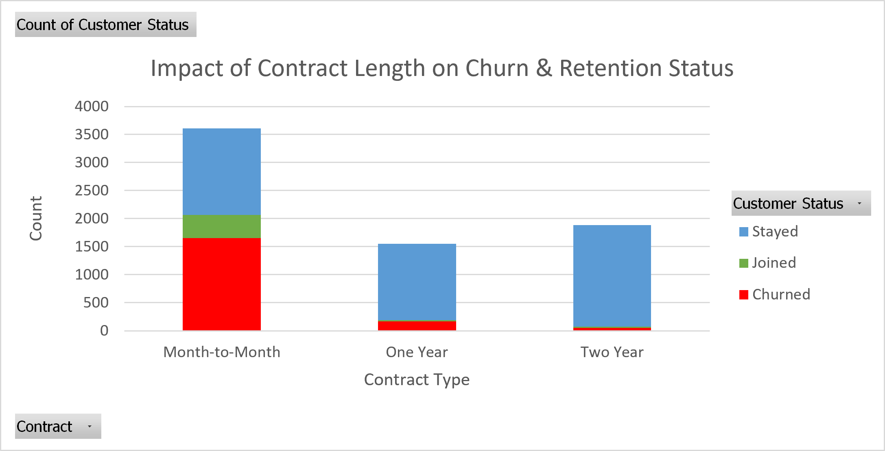
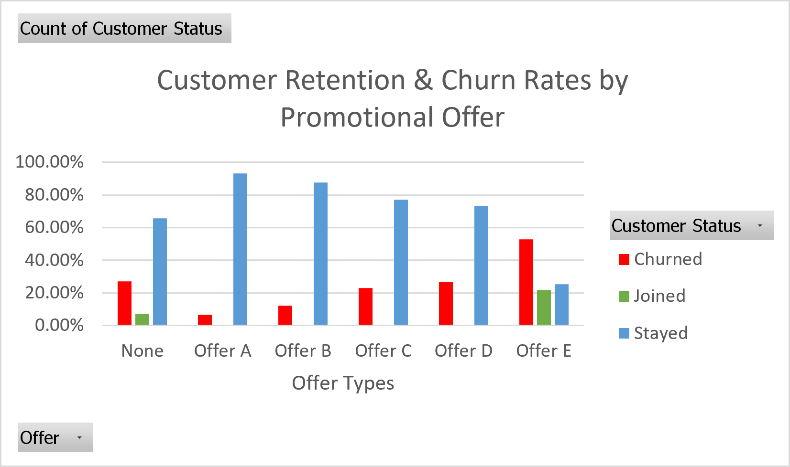
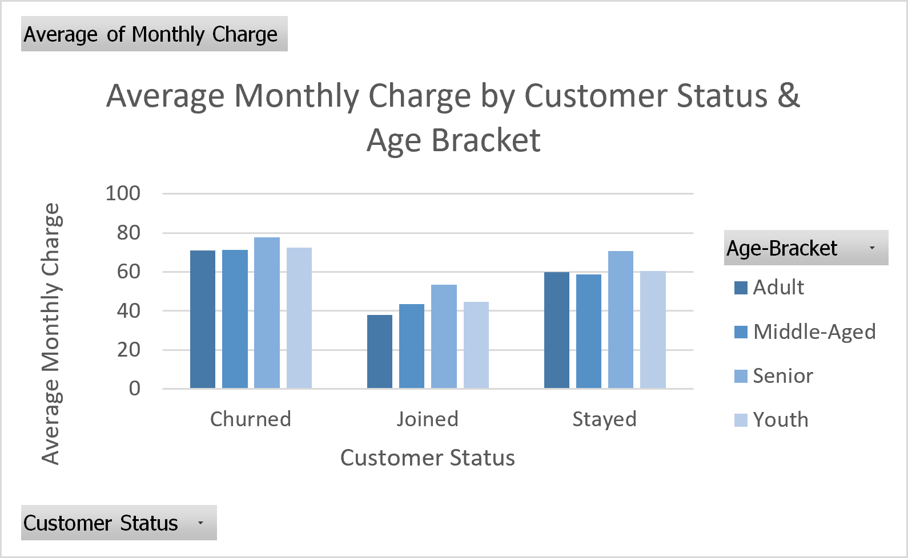
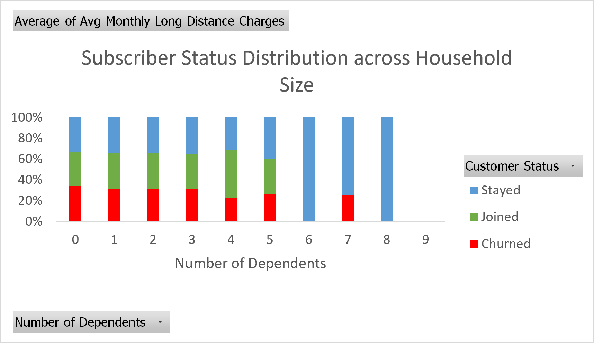
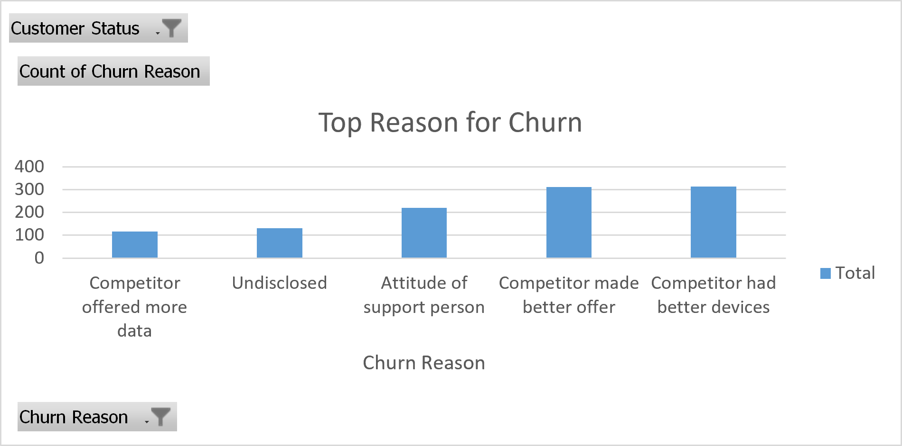

# 📊 Telecom Customer Churn & Retention Analysis

## 📌 Project Overview

This project analyzes customer churn and retention behavior within the telecommunications industry. With rapid shifts in communication technologies, customers increasingly demand higher-quality, reliable, and cost-effective services. Because telecommunication is highly prone to customer turnover, robust data analysis is essential for retaining existing subscribers and driving new account acquisition.

This project evaluates customer behavior across several key dimensions:

* **Contract Length & Agreements:** Month-to-Month, One Year, and Two Year terms

* **Promotional Strategy:** Performance of promotional offers (Offers A–E)

* **Billing & Pricing:** Monthly charges and spend patterns across age groups

* **Demographics & Family Size:** Age brackets and dependent counts

* **Root Cause Analysis:** Specific drivers causing customers to leave for competitors

---

## 🎯 Key Objectives

1. **Identify Primary Churn Drivers:** Pinpoint contract vulnerabilities, pricing thresholds, and service friction points that trigger customer departures.

2. **Evaluate Retention Tactics:** Assess the effectiveness of promotional offers and long-term contracts in maintaining subscriber loyalty.

3. **Formulate Actionable Strategies:** Develop targeted recommendations to reduce churn, optimize promotional offers, and protect high-value accounts.

---

## 📊 Visualizations & Data Analysis

### 1. Impact of Contract Length on Churn & Retention Status

* **Visual Type:** Stacked Column Chart

* **Key Findings:**

  * **Month-to-Month High Risk:** Month-to-month contracts contain the vast majority of total churned accounts (~1,600+ churned). Without contract lock-in, customers leave at an alarmingly high rate.

  * **Long-Term Stability:** **One Year** and **Two Year** contracts show near-zero churn rates, demonstrating that contract commitment is the strongest buffer against subscriber loss.

  * **Acquisition Channel:** Nearly all new **Joined** customers enter under Month-to-Month plans.

### 2. Customer Retention & Churn Rates by Promotional Offer

* **Visual Type:** Clustered Column Chart (Percentage Distribution)

* **Key Findings:**

  * **Offer A Benchmark:** Delivers the highest retention rate (**>90% Stayed**) and lowest churn (**<10%**).

  * **Offer E Vulnerability:** Over **50% of customers on Offer E churn**, making it the highest-risk promotion despite driving ~20% of new customer signups.

  * **Offer Degradation:** Moving from Offer B through Offer D shows a steady drop in retention and a progressive rise in churn.

### 3. Average Monthly Charge by Customer Status & Age Bracket

* **Visual Type:** Clustered Column Chart

* **Key Findings:**

  * **Price Sensitivity Trigger:** Across all age brackets, churned customers consistently averaged higher monthly bills ($70–$78/month).

  * **Senior Account Value:** **Senior** subscribers average the highest monthly charge across all categories, making senior churn the most financially damaging to total revenue.

  * **Entry Pricing:** Newly **Joined** subscribers start on significantly lower monthly plans ($38–$53/month).

### 4. Subscriber Status Distribution Across Household Size

* **Visual Type:** 100% Stacked Column Chart

* **Key Findings:**

  * **Single-Account Risk:** Accounts with 0 to 3 dependents maintain a consistent churn rate of ~30–35%.

  * **Family Account Retention:** Accounts with 4+ dependents show higher relative retention rates and lower churn, highlighting family plans as strong retention anchors.

  * **New Signup Distribution:** New signups (**Joined**) cluster predominantly in smaller household sizes (0 to 5 dependents).

### 5. Top Reasons for Churn

* **Visual Type:** Column Chart

* **Key Findings:**

  * **Competitor Pressure (Devices & Offers):** The top two explicit reasons customers churn are **"Competitor had better devices"** (~320 accounts) and **"Competitor made better offer"** (~310 accounts).

  * **Customer Service Friction:** **"Attitude of support person"** accounts for over 200 lost customers, representing a critical operational fix.

  * **Data Caps & Plan Limits:** Competitors offering more data accounts for ~100 additional churned users.

---

### Summary Matrix

| Metric / Dimension | Primary Observation | Actionable Recommendation |
| :--- | :--- | :--- |
| Contract Terms | Month-to-Month plans drive the vast majority of customer churn. | Offer financial incentives or device upgrades to convert Month-to-Month users into 1-Year or 2-Year contracts. |
| Promotional Offers | Offer A retains over 90% of users, whereas Offer E shows over 50% churn. | Phase out or restructure Offer E, and apply Offer A retention mechanics to new subscriber onboarding. |
| Monthly Charges | Churned customers show higher average monthly charges (~$70-$78) across all age brackets. | Implement automated price-lock alerts and proactive retention discounts for high-tier plan holders. |
| Competitive Losses | Competitors offering better devices, better offers, and more data are major drivers of churn. | Upgrade hardware trade-in programs and bundle competitive devices or data perks with long-term plans. |
| Customer Support | Support agent attitude contributes noticeably to customer churn[cite: 7]. | Retrain frontline support agents and establish clear escalation paths for dissatisfied callers. |
---

## 🛠️ Data Methodology & Logic

* **Tools Used:** Microsoft Excel (PivotTables, PivotCharts, Custom Array Formulas)

* **Status Categories:**

  * **Joined:** Newly acquired subscribers within the evaluation period

  * **Stayed:** Active, retained long-term accounts

  * **Churned:** Accounts canceled or lost to competitors

---

## 💡 Strategic Recommendations

1. **Contract Incentive Push:** Create targeted promotions converting Month-to-Month subscribers into 1-Year terms within their first 90 days of joining.

2. **Device Match Program:** Launch competitive hardware upgrade offerings to directly counteract losses to competitors offering better devices.

3. **Fix Frontline Support:** Conduct targeted customer service quality assurance to mitigate churn caused by poor support experiences.
